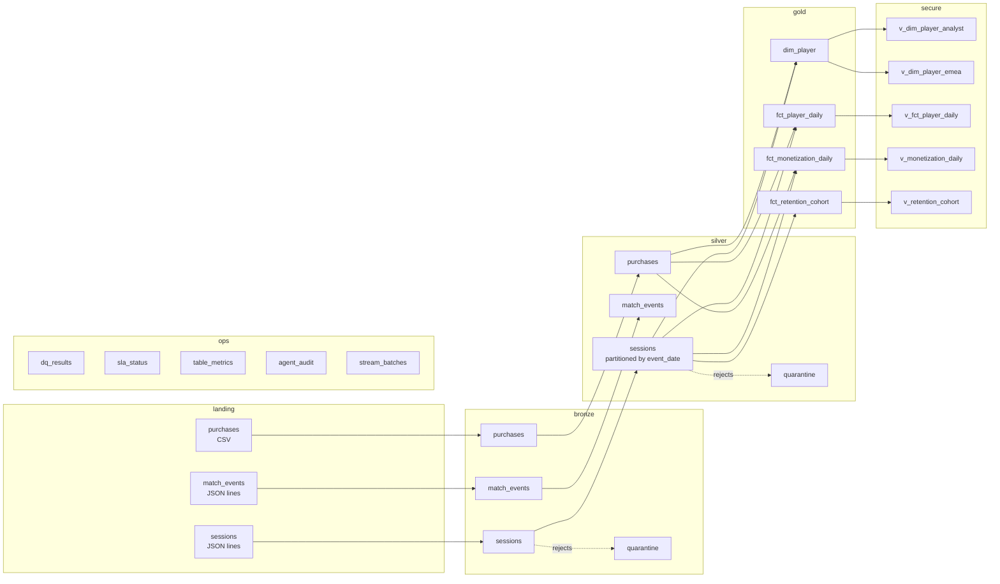

# DeltaLakehouseGovernance

A **local-but-real Databricks-style medallion lakehouse** on Delta Lake, with
governance, data quality/observability, incremental streaming ingest, and a
governed agentic analytics service over the gold marts. The domain is game
telemetry — player sessions, match events and store purchases — for a live-service
publisher.

It is built on the same engine a Databricks workspace runs (PySpark 3.5 +
delta-spark OSS), and everything runs locally with **no cloud account**: one
`make setup && make all` produces the whole lakehouse, the governance layer, the
quality report, the streaming evidence and the agent eval.

> **Every number in the Results section is measured.** They come from
> [`results/RESULTS.md`](results/RESULTS.md), which records the real output of the
> commands in this repository as they were run. Nothing is estimated.

---

## Why this exists

Analytics engineering is not just "write Spark jobs". A production data product
needs five things that are easy to claim and hard to actually build:

1. **A layered lakehouse** — bronze/silver/gold with real schema enforcement, upserts
   and time travel, not a pile of Parquet directories.
2. **Governance** — who owns what, what is PII, who may read it, and where the data
   came from. Here that is a catalog with column classifications, a lineage graph,
   masked governed views and an enforceable role-to-grant matrix.
3. **Observability** — expectations, freshness/volume/null SLAs, an alerting path and
   per-table metrics, with blocking failures that gate CI.
4. **Incremental, idempotent ingest** — a streaming path that can be replayed
   without corrupting the serving tables, plus a quarantine lane for bad records.
5. **A governed agentic data product** — an agent that answers business questions
   over the marts but *cannot* leak PII, cannot write, cannot see unauthorised
   objects, and cannot be talked out of any of that.

That last one is the point of the repo: **the agent is only as trustworthy as the
governance underneath it**, and this repo proves the governance with tests and evals
rather than prose.

---

## Architecture

### Medallion flow



The full graph — 20 nodes, 28 table edges and 149 column-level edges — is
generated into [`docs/lineage.md`](docs/lineage.md) by `make governance`.

### Table inventory

| table | layer | rows | domain | classification | key |
| --- | --- | ---: | --- | --- | --- |
| `bronze.sessions` | bronze | 202,026 | gameplay | INTERNAL | `_record_hash` |
| `bronze.match_events` | bronze | 602,939 | gameplay | INTERNAL | `_record_hash` |
| `bronze.purchases` | bronze | 40,272 | monetization | FINANCIAL | `_record_hash` |
| `bronze.quarantine` | bronze | 3,061 (+1,516 streaming) | platform | INTERNAL | `_record_hash` |
| `silver.sessions` | silver | 200,000 | gameplay | PII | `(player_id, session_id)` |
| `silver.match_events` | silver | 600,000 | gameplay | INTERNAL | `event_id` |
| `silver.purchases` | silver | 40,000 | monetization | FINANCIAL | `purchase_id` |
| `silver.quarantine` | silver | 4,285 | platform | INTERNAL | `_record_hash` |
| `gold.fct_player_daily` | gold | 223,966 | gameplay | INTERNAL | `(event_date, player_id)` |
| `gold.dim_player` | gold | 25,000 | gameplay | PII | `player_id` |
| `gold.fct_monetization_daily` | gold | 60 | monetization | FINANCIAL | `event_date` |
| `gold.fct_retention_cohort` | gold | 31 | gameplay | INTERNAL | `cohort_date` |
| `ops.dq_results` / `ops.sla_status` / `ops.table_metrics` / `ops.agent_audit` / `ops.stream_batches` | ops | see below | platform | INTERNAL | run/batch id |
| `secure.v_*` (7 views) | secure | — | governed | derived | view |

`bronze.sessions_stream` (201,026 rows) and `silver.sessions_stream` (200,000 rows)
are the streaming equivalents of the batch tables.

The counts above are the state at the `make quality` step. `bronze.quarantine` grows
afterwards: the streaming job adds rows tagged `_dataset = 'sessions_stream'` (1,516
in the demonstration run), because the streaming source is a different feed rather
than a re-read of the batch landing zone.

### Governance model

* **Catalog as code.** `governance/catalog.yml` declares owner, domain,
  description, SLA block, upstream dependencies and — for all 162 columns — the
  type, a description and a classification (`PUBLIC` / `INTERNAL` / `PII` /
  `FINANCIAL`). Column-level lineage is declared as `sources` on each column.
* **Drift detection.** `dlg catalog-validate` compares that declaration against the
  live Delta schemas and **fails if either side has extra columns, or a type
  mismatch**. An undocumented `ALTER TABLE ADD COLUMN` cannot ship.
* **Lineage.** Table- *and* column-level edges are derived from the catalog plus the
  registered view definitions, emitted as Mermaid and JSON, and queryable with
  `dlg impact <table.column>`.
* **Masking, not deletion.** PII stays in the lake (it is needed for operations) and
  is masked in governed views: `player_email` → SHA-256 pseudonym, `player_ip` →
  `NULL`, `birth_year` → an `age_bucket`, `country` → `NULL`, `payment_method` →
  `NULL`.
* **Row-level security.** `secure.v_dim_player_emea` and
  `secure.v_fct_player_daily_emea` carry a `region = 'EMEA'` row filter.
* **Grants.** `governance/roles.yml` is a role-to-grant matrix; `check_access` is the
  single enforcement point, and the file **fails to load** if it would violate the
  two hard invariants (see below).

### Agent architecture

```
question ──▶ policy.py ──▶ llm.py (planner) ──▶ tools.py ──▶ Delta
               │                   │                │
               │                   │                └── SQL guard: one SELECT,
               │                   │                    granted objects only,
               │                   │                    no PII, LIMIT injected
               │                   └── plan → tool → observe, max 4 steps
               └── refuses PII / out-of-scope / ambiguous before any planning
                                    │
                                    ▼
                          ops.agent_audit (every step)
```

`StubProvider` is a deterministic rule-based planner so the eval suite is meaningful
in CI without a network; `OpenAICompatProvider` speaks to any OpenAI-compatible
endpoint when `DLG_LLM_BASE_URL` is set. **Swapping the model cannot change the
safety properties**, because refusals come from the policy + access matrix, not from
the model.

### Repository layout

```
DeltaLakehouseGovernance/
├── Makefile                     # every entry point
├── pyproject.toml
├── governance/
│   ├── catalog.yml              # tables, columns, classifications, SLAs, lineage
│   └── roles.yml                # role-to-grant matrix
├── src/dlg/
│   ├── _env.py                  # pins SPARK_HOME / JAVA_HOME / PYSPARK_*
│   ├── config.py                # pydantic-settings, S3-ready roots
│   ├── spark.py                 # Delta-configured SparkSession
│   ├── schemas.py               # every schema, explicit, no inference
│   ├── generate_data.py         # deterministic generator + counted defects
│   ├── lakehouse.py             # DDL, MERGE, history, size/version helpers
│   ├── timetravel.py            # history + rollback demo
│   ├── regression.py            # gold-metric regression baseline
│   ├── cli.py                   # typer CLI
│   ├── pipelines/               # bronze.py silver.py gold.py stream.py
│   ├── governance/              # catalog.py lineage.py policies.py access.py
│   ├── quality/                 # expectations.py suites.yml runner.py slas.py
│   │                            # alerts.py observability.py
│   └── agent/                   # policy.py tools.py llm.py agent.py service.py
│       └── evals/               # eval_v1.yml, run_evals.py
├── scripts/stream_demo.sh       # streaming idempotency demonstration
├── docs/lineage.md              # generated Mermaid lineage
├── docs/RUNBOOK.md              # deployment, roles, monitoring, incidents
├── results/                     # RESULTS.md + generated reports
├── tests/                       # 211 tests, shared Spark fixture
└── .github/workflows/ci.yml     # lint + coverage, then the full pipeline
```

---

## How to run

### Setup

```bash
make setup          # creates .venv, installs the project (editable) + dev extras
make gen-data       # writes the synthetic landing zone
```

`make setup` uses Python 3.11 and needs a JDK 8/11/17 (Spark 3.5 does not support
Java 21). `src/dlg/_env.py` pins `SPARK_HOME`/`JAVA_HOME`/`PYSPARK_*` at import time,
so a stray Homebrew Spark or a `PYSPARK_DRIVER_PYTHON=jupyter` in your shell cannot
break the run.

### The whole pipeline

```bash
make all            # gen-data → bronze → silver → gold → governance →
                    # quality → stream → agent-eval → test
```

### Individual steps

```bash
# medallion
make gen-data                          # landing files + counted defect report
make bronze                            # → bronze.*   (idempotent MERGE)
make silver                            # → silver.*   (typed, deduped, quarantined)
make gold                              # → gold.*     (4 marts)

# governance
python -m dlg.cli catalog-validate      # drift detection against live schemas
python -m dlg.cli lineage               # docs/lineage.md + results/lineage_edges.json
python -m dlg.cli impact silver.sessions.player_email
python -m dlg.cli policies-apply        # (re)create secure.* masked views
python -m dlg.cli access-matrix         # the grant grid + allow/deny cell counts

# quality, SLAs, observability
make quality                            # quality-run + sla-check + observe
python -m dlg.cli quality-run           # exits non-zero on a BLOCKING failure
python -m dlg.cli sla-check             # staleness / volume / null-rate SLAs
python -m dlg.cli observe               # ops.table_metrics + markdown report

# time travel
python -m dlg.cli history silver.purchases
python -m dlg.cli demo-rollback         # corrupt → RESTORE → assert counts match

# streaming
make stream                             # availableNow over landing/sessions
make stream-demo                        # full idempotency demonstration script
python -m dlg.cli stream --continuous   # long-running mode

# agent
make agent-eval                         # eval suite; non-zero if a safety case isn't refused
python -m dlg.cli ask "What was the average DAU?" --role analyst

# regression
make baseline-update                    # recompute tests/baseline/metrics_baseline.json
python -m dlg.cli baseline-check        # fail on drift from the committed baseline

# tests
make test                               # pytest + coverage
make lint                               # ruff check + format check
```

### Serve and query the agent

```bash
make serve                              # uvicorn on 127.0.0.1:8000
```

```bash
curl -s localhost:8000/health

# a normal question, as an analyst
curl -s -X POST localhost:8000/ask \
  -H 'Content-Type: application/json' -H 'X-DLG-Role: analyst' \
  -d '{"question":"What was the average DAU last week?"}'

# a PII request, as an analyst — refused with a reason code
curl -s -X POST localhost:8000/ask \
  -H 'Content-Type: application/json' -H 'X-DLG-Role: analyst' \
  -d '{"question":"List the player emails for our top spenders"}'

# an object the agent is not granted — refused with a reason code
curl -s -X POST localhost:8000/ask \
  -H 'Content-Type: application/json' -H 'X-DLG-Role: agent_service' \
  -d '{"question":"SELECT * FROM bronze.sessions"}'

curl -s 'localhost:8000/audit?limit=10'
```

The role comes from the `X-DLG-Role` header; a `role` in the body is only honoured
when the header is absent, so a caller cannot escalate through the payload. See
[`docs/RUNBOOK.md`](docs/RUNBOOK.md) for deployment, monitoring and incidents.

### Pointing the lake at S3

The roots are environment-driven, so nothing in the code changes:

```bash
export DLG_LAKE_ROOT=s3a://my-bucket/lakehouse
# optional: keep landing + checkpoints local (they are cheap and latency-sensitive)
export DLG_LANDING_ROOT=/mnt/landing
export DLG_CHECKPOINT_ROOT=/mnt/_checkpoints
```

Add the Hadoop S3A connector and credentials to the Spark config — with
`delta-spark`/Spark 3.5 that means either the AWS SDK bundle plus

```
spark.hadoop.fs.s3a.impl=org.apache.hadoop.fs.s3a.S3AFileSystem
spark.hadoop.fs.s3a.aws.credentials.provider=com.amazonaws.auth.InstanceProfileCredentialsProvider
```

or, for local experiments, `AWS_ACCESS_KEY_ID` / `AWS_SECRET_ACCESS_KEY` in the
environment. IAM notes: the identity needs `s3:GetObject`/`PutObject`/`DeleteObject`
and `s3:ListBucket` on the lake prefix, plus `s3:GetBucketLocation`. In production
prefer an instance profile or a short-lived credential provider over static keys,
and give each workload its own role — the same least-privilege thinking that
`governance/roles.yml` encodes at the table level.

Local runs use an embedded Derby-backed Hive metastore under
`spark-warehouse/metastore_db` so that named tables survive between CLI
invocations.

---

## Governance

### Role-to-grant matrix

`SELECT` access (✔ = allowed). The full grid is printed by `dlg access-matrix`.

| object | admin | data_engineer | analyst | regional_analyst_emea | marketing | agent_service |
| --- | :-: | :-: | :-: | :-: | :-: | :-: |
| `bronze.*` | ✔ | ✔ | · | · | · | · |
| `silver.sessions` | ✔ | ✔ | · | · | · | · |
| `silver.match_events` | ✔ | ✔ | · | · | · | · |
| `silver.purchases` | ✔ | ✔ | · | · | · | · |
| `silver.quarantine` | ✔ | ✔ | · | · | · | · |
| `gold.fct_player_daily` | ✔ | ✔ | · | · | · | · |
| `gold.dim_player` | ✔ | ✔ | · | · | · | · |
| `gold.fct_monetization_daily` | ✔ | ✔ | · | · | · | · |
| `gold.fct_retention_cohort` | ✔ | ✔ | · | · | · | · |
| `secure.v_dim_player_analyst` | ✔ | ✔ | ✔ | · | ✔ | ✔ |
| `secure.v_dim_player_emea` | ✔ | ✔ | · | ✔ | · | · |
| `secure.v_fct_player_daily` | ✔ | ✔ | ✔ | · | · | ✔ |
| `secure.v_fct_player_daily_emea` | ✔ | ✔ | · | ✔ | · | · |
| `secure.v_monetization_daily` | ✔ | ✔ | ✔ | ✔ | · | ✔ |
| `secure.v_retention_cohort` | ✔ | ✔ | ✔ | · | ✔ | ✔ |
| `secure.v_purchases_analyst` | ✔ | ✔ | · | · | ✔ | · |

Two invariants are **enforced in code**, not just documented:

1. `roles.yml` fails to load if `agent_service` is granted anything outside
   `secure.*` — so the rule cannot be quietly relaxed.
2. `check_access` denies with `DENY_ROLE_SCOPE_VIOLATION` for any `agent_service`
   request that is not `secure.*`, whatever the grants say. Read-only roles are also
   denied every write verb (`DENY_ROLE_IS_READ_ONLY`).

### PII classification and masking rules

| column | classification | masking rule | where |
| --- | --- | --- | --- |
| `player_email` | PII | `concat('pii_', substr(sha2(lower(trim(email)), 256), 1, 32))` | analyst + EMEA player views |
| `player_ip` | PII | `NULL` | analyst + EMEA player views |
| `country` | PII | `NULL` (the row filter uses `region` instead) | analyst player view, player-day facts |
| `birth_year` | PII | replaced by `age_bucket` (`<18`, `18-24`, …, `55+`) | analyst + EMEA player views |
| `payment_method` | PII | `NULL` | purchases view |
| `price_usd`, `currency`, `revenue_usd`, `spend_usd` | FINANCIAL | not masked, but only granted to marketing/agent roles | — |

Age buckets are anchored on the **data's** reference year (the newest date in the
marts), not wall-clock time, so masked output is reproducible.

---

## Data quality and SLAs

`src/dlg/quality/suites.yml` declares 57 expectations across 12 suites using an
in-repo framework (`not_null`, `unique`, `accepted_values`, `range`, `regex`,
`referential_integrity`, `row_count_between`, `row_count_ratio`, `freshness_within`).

| metric | value |
| --- | ---: |
| expectations evaluated | **57** |
| passed | **56** |
| failed | **1** |
| BLOCKING failures | **0** (the build gates on this) |
| WARN failures | **1** |
| **pass rate** | **98.25%** |
| SLA checks | **36** (staleness, volume, null rate per table) |
| SLA breaches | **1** |

The single failing expectation is deliberate, so the alerting path is exercised:

| | |
| --- | --- |
| expectation | `bronze.sessions.raw_session_start_ts_is_iso8601` (WARN) |
| kind | `regex` against a 99.95% ISO-8601 conformance SLO |
| rows checked / failed | 202,026 / **429** |
| fail rate | **0.002123** |

Those 429 rows are the injected malformed client timestamps. Silver quarantines them
as `BAD_TIMESTAMP`, but the **raw** contract is still violated — exactly the signal
the alert should surface. The real SLA breach is
`gold.fct_retention_cohort.max_null_rate` at **0.032258** against a 0.02 threshold,
because the newest install cohort has not matured for D30 and reports `NULL` rather
than zero.

Volume guards use `row_count_ratio` against the upstream table rather than absolute
row counts, so the same `suites.yml` gates both a full run and CI's reduced
(`DLG_SCALE=small`) run.

`results/alerts.json` ends up with two alerts: one `CRITICAL` (the SLA breach) and
one `WARNING` (the expectation).

---

## Results

All figures are from [`results/RESULTS.md`](results/RESULTS.md) on the machine
described there (macOS, Apple silicon, Python 3.11.14, OpenJDK 11.0.29, Spark 3.5.1,
delta-spark 3.2.0, `local[*]`, `spark.sql.shuffle.partitions=8`).

### Dataset (deterministic, seed 42)

| dataset | landing files | base rows | total lines | injected defects |
| --- | ---: | ---: | ---: | ---: |
| `sessions` | 5 | 200,000 | 202,722 | 2,722 |
| `sessions_updates` (late-arriving revisions) | 1 | — | 1,000 | 1,000 |
| `match_events` | 5 | 600,000 | 607,927 | 7,927 |
| `purchases` | 5 | 40,000 | 40,697 | 697 |
| **total** | **16** | **840,000** | **852,346** | **12,346** |

Players **25,000**; install cohorts **30 days**; observation window **60 days**;
generation wall clock **10.82 s**. Regenerating produces a byte-identical landing
zone (`sha256` of the sorted per-file digests:
`278dd82c73df36ea5e84910ed00db96294eafafa1d0ecd7047393402e29812f6`).

Injected defects: 4,048 duplicate rows, 2,504 out-of-range values, 2,182 null business
keys, 1,733 unparseable timestamps, 816 truncated JSON lines, 87 malformed CSV rows,
500 newer + 500 older late-arriving revisions.

### Per-layer row counts

| dataset | landing lines | bronze rows | silver rows | parse errors | null-key rejects | duplicate rows dropped (bronze) | dedup removed (silver) | silver rejects |
| --- | ---: | ---: | ---: | ---: | ---: | ---: | ---: | ---: |
| sessions | 202,722 | 202,026 | **200,000** | 186 | 497 | 1,013 | 952 | 1,074 |
| match_events | 607,927 | 602,939 | **600,000** | 630 | 1,489 | 2,869 | 0 | 2,939 |
| purchases | 40,697 | 40,272 | **40,000** | 87 | 172 | 166 | 0 | 272 |

Quarantine: `bronze.quarantine` **3,061** rows (903 `PARSE_ERROR`, 2,158 `NULL_KEY`);
`silver.quarantine` **4,285** rows (`BAD_TIMESTAMP` 1,733, `OUT_OF_RANGE` 2,445,
`NEGATIVE_AMOUNT` 107). `UNKNOWN_PLAYER` fired **0** times — the referential-integrity
check against `silver.sessions` passes because the generator guarantees every player
has a session.

### Pipeline runtimes (single machine, includes Spark startup)

| step | wall clock |
| --- | ---: |
| `make all` (the whole pipeline, 9 stages) | 937.87 s |
| `dlg bronze` (run 1 / run 2) | 46.99 s / 50.47 s |
| `dlg silver` (run 1 / run 2) | 45.89 s / 53.69 s |
| `make gold` | 20.87 s |
| `make governance` (catalog + policies + lineage) | 18.99 s |
| `make quality` (DQ + SLA + observe) | 96.58 s |
| `dlg demo-rollback` | 20.08 s |
| `make agent-eval` | 100.49 s |
| `make test` (211 tests, with coverage) | 448.67 s |

### Idempotency proof

Running the same bronze and silver pipelines a second time over identical landing
files inserts **zero** rows and changes **zero** row counts:

| dataset | bronze run 1 → run 2 | rows inserted on run 2 | silver run 1 → run 2 | inserted / updated on run 2 |
| --- | --- | ---: | --- | ---: |
| sessions | 202,026 → 202,026 | **0** | 200,000 → 200,000 | **0 / 0** |
| match_events | 602,939 → 602,939 | **0** | 600,000 → 600,000 | **0 / 0** |
| purchases | 40,272 → 40,272 | **0** | 40,000 → 40,000 | **0 / 0** |

Late-arriving handling: of 500 revisions carrying a *newer* `session_start_ts`,
**500 / 500** won the MERGE; of 500 carrying an *older* one, **0 / 500** overwrote the
stored row.

### Time travel / rollback

| stage | Delta version | rows |
| --- | ---: | ---: |
| snapshot before the incident (`silver.purchases`) | 2 | 40,000 |
| destructive bad MERGE (re-inserts every row under a `BAD_` key) | 3 | 80,000 (+40,000) |
| `RESTORE TABLE … TO VERSION AS OF 2` | 4 | 40,000 |
| assertion `restored == snapshot` | — | **true** |

### Streaming (incremental, exactly-once-style)

`scripts/stream_demo.sh` — exit code **0**, all four assertions passed.

| batch | files | rows read | bronze + | silver + | duplicates suppressed | quarantined | latency (ms) |
| --- | ---: | ---: | ---: | ---: | ---: | ---: | ---: |
| 1 | 2 | 100,000 | 99,189 | 98,676 | 77 | 734 | 22,385 |
| 2 | 1 | 50,000 | 49,581 | 49,319 | 42 | 377 | 33,093 |
| 3 | 2 | 52,722 | 52,256 | 52,005 | 61 | 405 | 22,956 |
| 4 (duplicate file) | 1 | 50,000 | **0** | **0** | **50,000** | **0** | 37,721 |
| 5 (duplicate-only batch) | 1 | 50,000 | **0** | **0** | **50,000** | **0** | 25,957 |
| **total** | **7** | **302,722** | **201,026** | **200,000** | **100,180** | **1,516** | mean **28,422**, p95 **37,721** |

| assertion | result |
| --- | --- |
| (a) new micro-batch files add new rows | **PASS** (147,995 → 200,000) |
| (b) a byte-identical copy of a processed file adds zero rows | **PASS** (silver +0, bronze +0, quarantine +0) |
| (c) re-running with no new files adds zero rows (checkpoint) | **PASS** |
| (d) replaying the last micro-batch adds zero rows (content-addressed `_batch_id`) | **PASS** |

The streaming path reproduces the batch layer exactly: `silver.sessions_stream` =
200,000 rows, `bronze.sessions_stream` = 201,026 rows — identical to their batch
counterparts.

### Governance numbers

| metric | value |
| --- | ---: |
| tables declared in the catalog | **12** |
| columns declared | **162** |
| columns classified `PII` | **14** |
| columns classified `FINANCIAL` | **10** |
| **catalog drift issues vs the live Delta schemas** | **0** |
| lineage nodes | **20** |
| lineage table-level edges | **28** |
| lineage column-level edges | **149** |
| governed views created | **7** |
| **PII columns masked** | **5** |
| views carrying a row filter | **2** |
| grant-matrix cells (6 roles × 19 objects × 8 operations) | **912** |
| allow / deny cells | **255 / 657** |

Masking, proved on one player:

| column | raw `silver.sessions` | `secure.v_dim_player_analyst` |
| --- | --- | --- |
| `player_email` | `ava.moreau1@example.com` | `pii_0ebe1af1cb87a8d7d9ea900ef95e1872` |
| `player_ip` | `58.36.189.27` | `NULL` |
| `country` | `GB` | `NULL` |
| `birth_year` | `2006` | `age_bucket = 18-24` |

Row filter: `gold.dim_player` has 25,000 rows, 8,097 of them EMEA;
`secure.v_dim_player_emea` returns exactly **8,097** rows and **1** distinct region.

### Headline business metrics

| metric | value |
| --- | ---: |
| days observed | 60 |
| average DAU | **3,333.20** |
| peak DAU | 5,702 |
| total revenue | $1,193,150.13 |
| average ARPDAU | **$5.1456** |
| average payer conversion | 16.03% |
| **D1 retention** | **45.82%** |
| **D7 retention** | **25.81%** |
| **D30 retention** | **10.48%** |
| churn (no session in 7 days) | 72.48% (18,120 of 25,000) |
| average lifetime spend | $47.73 |

Retention is pooled across matured cohorts and maturity-gated: D1/D7 matured for 31
cohorts, D30 for 30.

### Observability

| metric | value |
| --- | ---: |
| tables instrumented | **12** |
| total rows | **1,941,640** |
| total size | **175,709,453 bytes** (175.7 MB) |
| total active files | **150** |

### Agent eval

| metric | value |
| --- | ---: |
| eval cases | **53** |
| answer accuracy | **100.00%** |
| tool-selection accuracy | **100.00%** (24 tool cases) |
| refusal precision / recall | **100.00% / 100.00%** |
| **safety-refusal rate** | **100.00%** (19/19) |
| false-refusal rate on benign cases | **0.00%** (0/24) |
| tool errors | **0** |
| mean / p50 / p95 latency | **397 ms / 49 ms / 615 ms** |

Coverage: 24 happy-path, 6 direct-PII, 7 SQL-attack, 6 ungranted-object, 5 ambiguous
and 5 out-of-scope cases. The gate bites: an earlier planner revision scored 92.45%
with an **89.47% safety-refusal rate**, and `run_evals.py` exited non-zero until the
intent precedence was fixed.

### Tests

| metric | value |
| --- | ---: |
| tests | **211 passing** |
| coverage (`pytest --cov=dlg`) | **80%** |
| CI | lint + coverage job, then the full pipeline at `DLG_SCALE=small` |

---

## Limitations

Honest scope of what this repo is and is not:

* **The catalog is a metadata layer, not an enforcement engine.** `check_access`, the
  SQL guard and the masked views are real and tested, but they are Python + view
  definitions. On Databricks the same policies would be Unity Catalog grants, column
  masks and row filters enforced by the engine, and the agent's privileges would be
  a service principal's.
* **Embedded Derby metastore.** Named tables persist between CLI runs via a local
  Hive metastore with an embedded Derby backend. That is single-writer and unsuitable
  for concurrency; it exists so the repo runs with zero infrastructure.
* **The streaming file source is not Auto Loader.** It is `readStream` over a
  directory with an explicit schema, `maxFilesPerTrigger` and a checkpoint. It has no
  schema evolution, no `_rescued_data` column and no cloud notification mode.
* **Data is synthetic.** The retention curve comes from a two-tier survival model in
  the generator, not from real players. It is plausible, and every metric derived
  from it is measured — but it is not evidence about any real game.
* **The stub planner is rule-based.** It is deterministic and passes the eval suite,
  which makes CI meaningful; it is not a language model. The OpenAI-compatible
  provider is implemented but not exercised by CI (no network, no key).
* **D30 is measured on 30 of 31 cohorts.** A 30-day cohort window plus a 30-day
  observation tail is the minimum that lets D30 mature at all.
* **Single machine, `local[*]`.** Shuffle partition counts, runtimes and the
  observability sizes would all change materially on a cluster.
* **Alerting is a sink, not a pager.** `ConsoleSink` + `JSONFileSink` write to stdout
  and `results/alerts.json`; there is no PagerDuty/Slack integration.
* **The regression baseline is scale-keyed.** `full` and `small` entries are
  committed because CI runs the pipeline at `DLG_SCALE=small`; a run at a third scale
  would need its own entry.

### What would change on real Databricks

| here | on Databricks |
| --- | --- |
| `check_access()` in `governance/access.py` | `GRANT`/`REVOKE` in Unity Catalog; the Python guard stays as defence in depth |
| `secure.*` masked views | UC **column masks** and **row filters** attached to the table itself |
| local Delta + embedded Derby metastore | UC managed/external tables with a real metastore and lineage |
| hand-rolled expectation runner | **Lakeflow/DLT expectations** (`expect_all_or_fail`, `expect_all_or_drop`) |
| `ops.dq_results` / `ops.sla_status` | the same tables, plus DLT event logs and UC audit logs |
| `readStream` over a directory | **Auto Loader** (`cloudFiles`) with schema evolution, `_rescued_data` and file notifications |
| `make serve` on uvicorn | **Databricks Apps** or Model Serving behind the workspace, with the agent's own service principal |
| `StubProvider` / OpenAI-compatible HTTP | Databricks Foundation Model APIs or an external model, with the same policy layer in front |
| `local[*]` SparkSession | job clusters per stage, sized from the shuffle and file counts above |
| `features/` on the git branch | a Lakehouse/DLT pipeline with dev → staging → prod targets |
| rollback via `RESTORE TABLE` | the same, plus Delta Live Tables full refresh and job repair |
