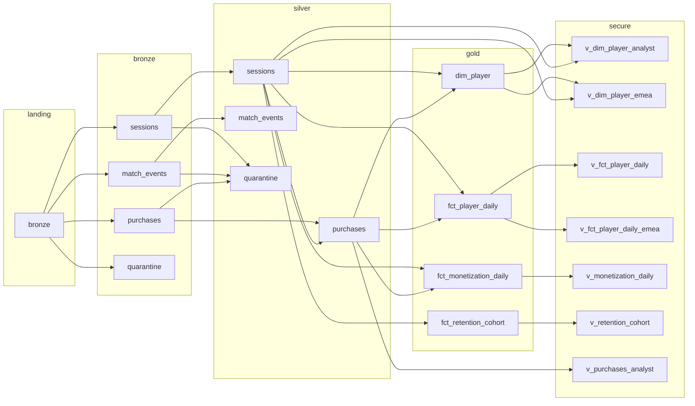

# Lineage

Generated by `dlg lineage` from `governance/catalog.yml` (registered upstream
dependencies and per-column `sources`). Do not edit by hand.

* nodes: **20**
* table-level edges: **27**
* column-level edges: **149**

## Table-level lineage



| upstream | downstream |
| --- | --- |
| `landing.bronze` | `bronze.match_events` |
| `landing.bronze` | `bronze.purchases` |
| `landing.bronze` | `bronze.quarantine` |
| `landing.bronze` | `bronze.sessions` |
| `silver.purchases` | `gold.dim_player` |
| `silver.sessions` | `gold.dim_player` |
| `silver.purchases` | `gold.fct_monetization_daily` |
| `silver.sessions` | `gold.fct_monetization_daily` |
| `silver.purchases` | `gold.fct_player_daily` |
| `silver.sessions` | `gold.fct_player_daily` |
| `silver.sessions` | `gold.fct_retention_cohort` |
| `gold.dim_player` | `secure.v_dim_player_analyst` |
| `silver.sessions` | `secure.v_dim_player_analyst` |
| `gold.dim_player` | `secure.v_dim_player_emea` |
| `silver.sessions` | `secure.v_dim_player_emea` |
| `gold.fct_player_daily` | `secure.v_fct_player_daily` |
| `gold.fct_player_daily` | `secure.v_fct_player_daily_emea` |
| `gold.fct_monetization_daily` | `secure.v_monetization_daily` |
| `silver.purchases` | `secure.v_purchases_analyst` |
| `gold.fct_retention_cohort` | `secure.v_retention_cohort` |
| `bronze.match_events` | `silver.match_events` |
| `bronze.purchases` | `silver.purchases` |
| `silver.sessions` | `silver.purchases` |
| `bronze.match_events` | `silver.quarantine` |
| `bronze.purchases` | `silver.quarantine` |
| `bronze.sessions` | `silver.quarantine` |
| `bronze.sessions` | `silver.sessions` |

## Column-level lineage (gold marts)

```mermaid
flowchart LR
  c0["silver<br/>sessions.event_date"]
  c1["gold<br/>fct_player_daily.event_date"]
  c2["silver<br/>purchases.event_date"]
  c3["silver<br/>sessions.player_id"]
  c4["gold<br/>fct_player_daily.player_id"]
  c5["silver<br/>purchases.player_id"]
  c6["silver<br/>sessions.country"]
  c7["gold<br/>fct_player_daily.country"]
  c8["silver<br/>sessions.region"]
  c9["gold<br/>fct_player_daily.region"]
  c10["silver<br/>sessions.session_id"]
  c11["gold<br/>fct_player_daily.sessions"]
  c12["silver<br/>sessions.duration_minutes"]
  c13["gold<br/>fct_player_daily.playtime_minutes"]
  c14["silver<br/>sessions.matches_played"]
  c15["gold<br/>fct_player_daily.matches"]
  c16["silver<br/>sessions.kills"]
  c17["gold<br/>fct_player_daily.kills"]
  c18["silver<br/>sessions.deaths"]
  c19["gold<br/>fct_player_daily.deaths"]
  c20["silver<br/>purchases.price_usd"]
  c21["gold<br/>fct_player_daily.spend_usd"]
  c22["silver<br/>purchases.quantity"]
  c23["gold<br/>dim_player.player_id"]
  c24["silver<br/>sessions.session_start_ts"]
  c25["gold<br/>dim_player.first_seen"]
  c26["gold<br/>dim_player.last_seen"]
  c27["gold<br/>dim_player.country"]
  c28["gold<br/>dim_player.region"]
  c29["gold<br/>dim_player.lifetime_spend"]
  c30["gold<br/>dim_player.lifetime_sessions"]
  c31["gold<br/>dim_player.lifetime_playtime_minutes"]
  c32["gold<br/>dim_player.days_since_last_seen"]
  c33["gold<br/>dim_player.churn_flag"]
  c34["gold<br/>fct_monetization_daily.event_date"]
  c35["gold<br/>fct_monetization_daily.dau"]
  c36["gold<br/>fct_monetization_daily.paying_users"]
  c37["gold<br/>fct_monetization_daily.revenue_usd"]
  c38["gold<br/>fct_monetization_daily.arpdau"]
  c39["gold<br/>fct_monetization_daily.conversion_rate"]
  c40["gold<br/>fct_monetization_daily.sessions"]
  c41["silver<br/>purchases.purchase_id"]
  c42["gold<br/>fct_monetization_daily.purchases"]
  c43["gold<br/>fct_retention_cohort.cohort_date"]
  c44["gold<br/>fct_retention_cohort.cohort_size"]
  c45["gold<br/>fct_retention_cohort.d1_retained"]
  c46["gold<br/>fct_retention_cohort.d7_retained"]
  c47["gold<br/>fct_retention_cohort.d30_retained"]
  c48["gold<br/>fct_retention_cohort.d1_retention"]
  c49["gold<br/>fct_retention_cohort.d7_retention"]
  c50["gold<br/>fct_retention_cohort.d30_retention"]
  c51["gold<br/>fct_retention_cohort.is_matured_d7"]
  c52["gold<br/>fct_retention_cohort.is_matured_d30"]
  c0 --> c1
  c2 --> c1
  c3 --> c4
  c5 --> c4
  c6 --> c7
  c8 --> c9
  c10 --> c11
  c12 --> c13
  c14 --> c15
  c16 --> c17
  c18 --> c19
  c20 --> c21
  c22 --> c21
  c3 --> c23
  c24 --> c25
  c24 --> c26
  c6 --> c27
  c8 --> c28
  c20 --> c29
  c22 --> c29
  c10 --> c30
  c12 --> c31
  c0 --> c32
  c32 --> c33
  c0 --> c34
  c2 --> c34
  c3 --> c35
  c5 --> c36
  c20 --> c37
  c22 --> c37
  c20 --> c38
  c3 --> c38
  c5 --> c39
  c3 --> c39
  c10 --> c40
  c41 --> c42
  c0 --> c43
  c3 --> c43
  c3 --> c44
  c3 --> c45
  c0 --> c45
  c3 --> c46
  c0 --> c46
  c3 --> c47
  c0 --> c47
  c45 --> c48
  c44 --> c48
  c46 --> c49
  c44 --> c49
  c47 --> c50
  c44 --> c50
  c0 --> c51
  c0 --> c52
```



### PII propagation

These edges show classified PII columns flowing downstream. Every one of them is
masked by a governed view before an analyst or the agent service can read it.

| upstream column | downstream column |
| --- | --- |
| `silver.sessions.country` | `gold.dim_player.country` |
| `silver.sessions.country` | `gold.fct_player_daily.country` |
| `silver.sessions.birth_year` | `secure.v_dim_player_analyst.age_bucket` |
| `silver.sessions.country` | `secure.v_dim_player_analyst.country` |
| `silver.sessions.player_email` | `secure.v_dim_player_analyst.player_email` |
| `silver.sessions.player_ip` | `secure.v_dim_player_analyst.player_ip` |
| `silver.sessions.birth_year` | `secure.v_dim_player_emea.age_bucket` |
| `silver.sessions.country` | `secure.v_dim_player_emea.country` |
| `silver.sessions.player_email` | `secure.v_dim_player_emea.player_email` |
| `silver.sessions.player_ip` | `secure.v_dim_player_emea.player_ip` |
| `gold.fct_player_daily.country` | `secure.v_fct_player_daily.country` |
| `silver.purchases.payment_method` | `secure.v_purchases_analyst.payment_method` |
| `bronze.purchases.payment_method` | `silver.purchases.payment_method` |
| `bronze.sessions.birth_year` | `silver.sessions.birth_year` |
| `bronze.sessions.country` | `silver.sessions.country` |
| `bronze.sessions.player_email` | `silver.sessions.player_email` |
| `bronze.sessions.player_ip` | `silver.sessions.player_ip` |

## Impact analysis

`python -m dlg.cli impact <table.column>` walks this graph downstream, e.g.

```
$ python -m dlg.cli impact silver.sessions.player_email
silver.sessions.player_email impacts 2 downstream columns across 2 tables:
  secure.v_dim_player_analyst.player_email
  secure.v_dim_player_emea.player_email
```

Note how every PII column terminates in a ``secure.*`` view: there is no path from
``player_email`` into a raw gold table, which is exactly the property the access
matrix relies on.
